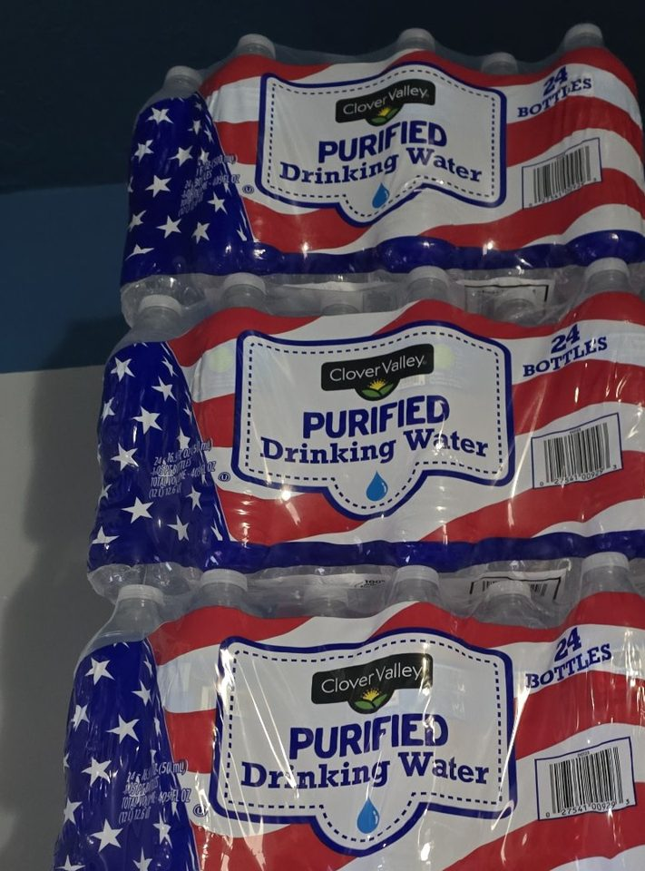
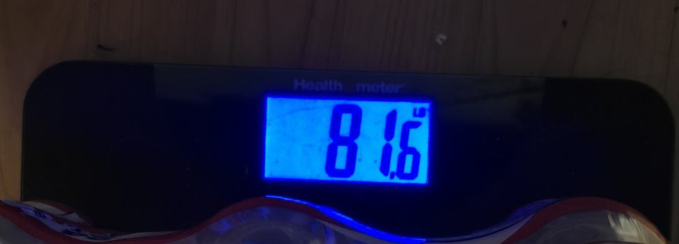
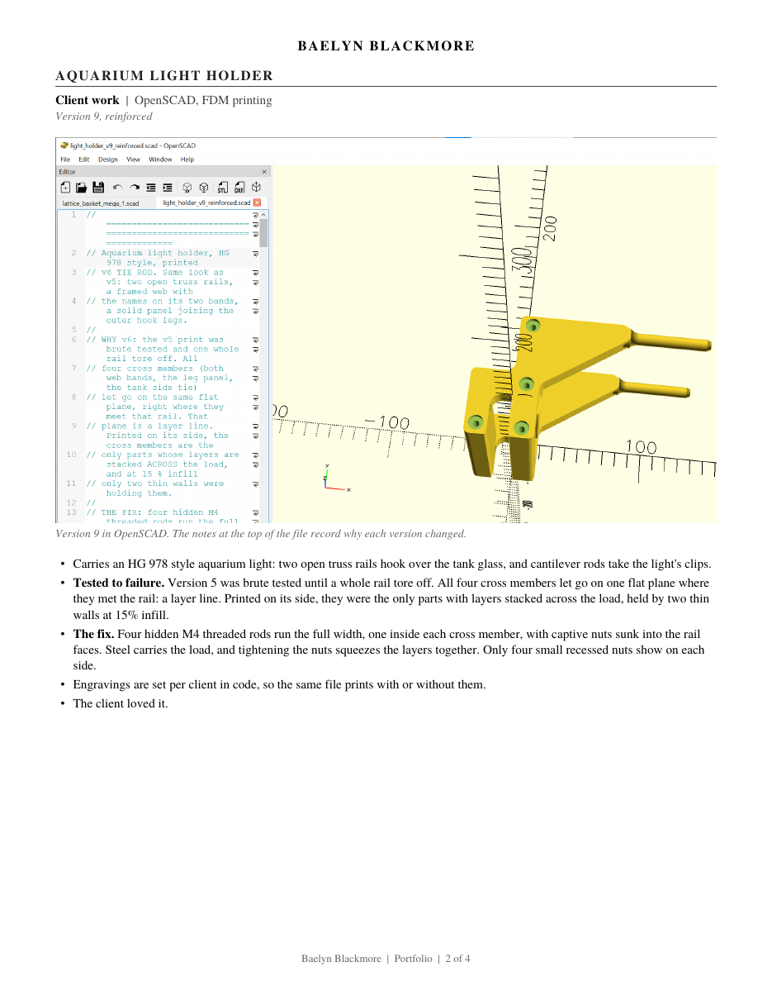
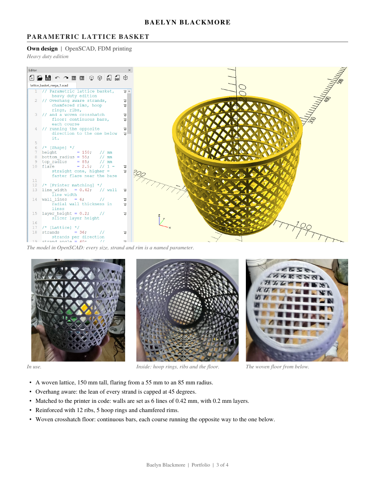
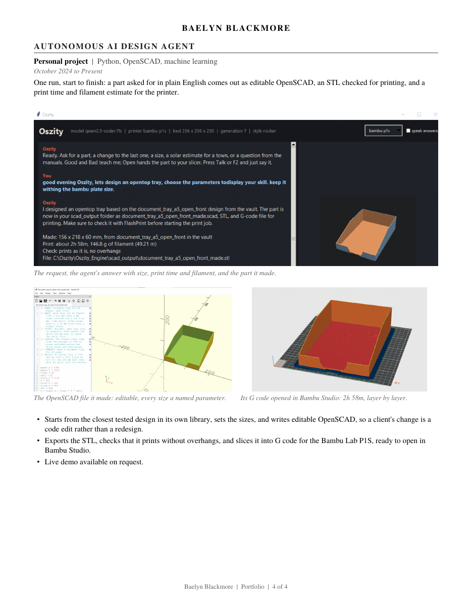

# Baelyn Blackmore, Portfolio

Parametric design in OpenSCAD, FDM printing on a Bambu Lab P1S and a Flashforge Adventurer 5M, and an AI agent that turns a plain English request into a printable part.

**[Download the full portfolio (PDF)](Blackmore_Portfolio.pdf)**

## Modular click lock shelving

Held 81 lb for over 6 hours. Carries 30 lb comfortably, and has held about 15 lb for the past 2 weeks. Built for an unsupported 16 inch span, matching US stud spacing. Panels join at each seam with printed click lock keys.

## Aquarium light holder (client work)

Version 5 was tested until a whole rail tore off along a layer line. From version 6 on, four hidden M4 threaded rods run through the cross members, so steel carries the load and the nuts squeeze the layers together.

## Parametric lattice basket

Every strand's lean is capped at 45 degrees, the walls are matched to the printer's line width in code, and the basket is reinforced with 12 ribs, 5 hoop rings and a woven floor.

## AI design agent (personal project)

One sentence in; editable OpenSCAD, a checked STL and G code for the printer out. Live demo available on request.

Contact: baelyn.k.blackmore112895@outlook.com
